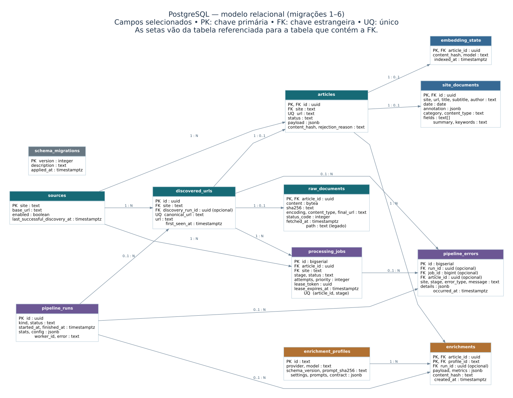

# Database, control, and recovery

PostgreSQL is the source of truth for the durable pipeline. It records every
article, every unit of work, every annotation, every run, and every failure.
Jobs can be retried after interruption, and stored results can be traced to the
run and configuration that produced them. A remote request may be repeated if
the worker crashes or loses its lease before the result is committed.

## Setting up PostgreSQL

Use one of the two options below. Both create the `university_news` database
used by `DATABASE_URL`.

The website now queries this same PostgreSQL database. Its BM25 search also
requires pg_search 0.26.4+ and pgvector installed on the server, with pg_search
preloaded. The portable bootstrap below initializes the pipeline database but
does not install those extensions; its old PostgreSQL 16.2 binaries need an
upgrade before using the tested pg_search package. See [site.md](site.md) for
the website migration and the read-only role.

On the current rootless deployment, PostgreSQL 16.15 and pg_search 0.26.4 are
installed separately under `data/postgres/pg16-search-0.26.4`. A systemd user
drop-in selects those binaries and preloads pg_search; the previous 16.2
installation and a verified pre-upgrade dump remain available. On a new host,
install compatible server binaries, pgvector and pg_search and preload
`pg_search` before initializing the site. Creating the extensions requires a
database superuser even when the app role owns the database:

```sql
CREATE EXTENSION IF NOT EXISTS vector;
CREATE EXTENSION IF NOT EXISTS pg_search;
```

Then run `uv run university-news-site init-search` as the application role to
create the BM25 index. Do not run old workers concurrently with a schema or
server upgrade.

**Without root or Docker access** (the setup used on the lab server):

```bash
./scripts/setup_local_postgres.sh
```

The script:

1. finds PostgreSQL 16 binaries (`PG_BIN`, `pg_ctl` on `PATH`, or installs the
   portable `pgserver` wheel under `data/postgres/venv`);
2. creates a cluster in `data/postgres/data`, on `/exp` with the rest of the
   project, listening only on `127.0.0.1:5432`. PostgreSQL accepts NFS mounted
   with `hard` and server-side locking (`local_lock=none`), which is how
   `/exp` is mounted. The Unix socket cannot live on NFS, so it goes to `/tmp`;
3. installs and starts the systemd user service `university-news-postgres`,
   which restarts on failure and starts at boot when lingering is enabled
   (`loginctl enable-linger "$USER"`);
4. creates the `university_news` role, a generated password, and the
   `university_news` and `university_news_test` databases;
5. writes `DATABASE_URL` to `.env` (an existing value other than the
   `change-me` placeholder is never overwritten);
6. applies the schema with `university-news-db init`.

Rerunning it is safe. Set `UNIVERSITY_NEWS_PG_HOME`,
`UNIVERSITY_NEWS_PG_SOCKET_DIR`, or `UNIVERSITY_NEWS_PG_PORT` to change the
location, socket directory, or port.

**With Docker access:**

```bash
POSTGRES_PASSWORD=choose-one docker compose up -d --build
# then set DATABASE_URL in .env and run:
uv run university-news-db init
uv run university-news-site init-search
```

### Backups

The live cluster is in `data/postgres/`; never copy that directory while the
server runs. `scripts/backup_database.sh` writes a full dump to
`data/backups/` daily at 03:30 (`university-news-backup.timer`, installed by
`install_user_services.sh`), keeping the 14 newest. To restore a dump:

```bash
pg_restore --clean --if-exists --dbname="$DATABASE_URL" data/backups/university_news-YYYYMMDD-HHMMSS.dump
```

Manual dumps work the same way:

```bash
pg_dump --format=custom --file=university_news.dump "$DATABASE_URL"
pg_restore --clean --dbname="$DATABASE_URL" university_news.dump
```

With the rootless setup, both tools are in the `pgserver` installation:
`find data/postgres/venv -name pg_dump`.

## Schema and migrations

`operations/database_schema.py` holds an ordered list of migrations. Every
command applies the pending ones under an advisory lock, each in its own
transaction, and records them in `schema_migrations`. Never edit an applied
migration; append a new one and a test.



The diagram shows selected fields and all declared foreign keys as of migration
6. Relationships marked `0..1` are optional; `N` means zero or more. The
standalone migration table has no foreign keys. `site_documents` is a
transactionally maintained projection; `embedding_state` tracks index state,
while the vectors themselves live in LanceDB, outside PostgreSQL. The editable
diagram source is [database-relational.dot](database-relational.dot).

| Table | Contents |
| --- | --- |
| `sources` | registered universities and discovery state |
| `discovered_urls` | every URL ever seen, keyed by the canonical-URL article ID |
| `raw_documents` | HTML bytes (`BYTEA`), checksum, encoding, content type, final URL, HTTP status and fetch time |
| `articles` | extracted, accepted, or rejected articles (`payload` holds the record) |
| `site_documents` | transactional read projection of accepted articles and their latest annotations; BM25 indexed |
| `processing_jobs` | the work queue: one job per article and stage |
| `enrichment_profiles` | every enrichment configuration ever used (see below) |
| `enrichments` | one annotation per article **and profile**, with metrics and run |
| `embedding_state` | which content hash was indexed with which model |
| `pipeline_runs` | every worker or daily run, its configuration snapshot, and totals |
| `pipeline_errors` | every failure, with its run, job, and details |
| `schema_migrations` | applied schema versions |

## Enrichment profiles

A profile is everything that determines an annotation: provider, model, schema
version, the SHA-256 of the exact prompts, and the generation settings
(temperature, calls, input and output limits, thinking, JSON mode, validation
attempts). Its ID is readable and stable, for example
`nemotron-3-ultra-550b-a55b-v2.1.0-2c780ff3ac`.

- Changing any of those values creates a new profile automatically. Nothing is
  overwritten; both profiles coexist and can be compared.
- The endpoint URL, keys, and pacing are not part of the profile. They do not
  change the output and are recorded in each run's configuration instead.
- Annotations made before profiles existed are kept under a `legacy-…` profile.

```bash
uv run university-news-db profiles     # every profile and how many annotations it has
```

## Job lifecycle

```text
          claim (lease)              success
queued ───────────────► running ───────────────► completed
  ▲                       │
  │  transient error and  │ permanent error, or
  │  attempts remaining   │ attempts exhausted
  └───────────────────────┤
                          ▼
                        failed ──── retry (manual) ───► queued
```

- **Claiming** uses `FOR UPDATE SKIP LOCKED`. Each claim receives a unique
  lease token, even if a worker name or attempt number is reused. A separate
  connection renews the lease (`[workers].lease_seconds`) with a heartbeat.
- **Lease ownership:** PostgreSQL writes and LanceDB writes lock and check the
  active job before changing results. Renewal, failure and completion require
  the same unexpired token; an obsolete attempt cannot enqueue the next stage.
  A claimant skips a job locked for an in-progress write, even if its lease
  expires during that write. LanceDB is outside the PostgreSQL transaction: if
  the PostgreSQL connection dies during a LanceDB write, the lock can be lost
  while that write is still in flight; retry and reconciliation remain necessary.
- **Crash or kill -9:** the lease expires and another worker reclaims the job.
- **Stop (SIGTERM, Ctrl-C, `systemctl stop`):** workers finish the job in hand,
  then exit. The run is recorded as `interrupted`.
- **Transient errors** (timeouts, connection errors, HTTP 5xx, or 429s that
  persist after the client's own retries) return the job to the queue after
  1, 5, 25 minutes, and so on, up to `[workers].max_attempts`. The worker
  thread then pauses before claiming again (30 s, doubling up to 10 min), so a
  provider that is down does not exhaust jobs another provider could finish.
- **Permanent errors** (for example, output still invalid after its correction
  attempts) fail the job immediately. Failed jobs never retry on their own:
  inspect them with `errors`, then requeue them with `retry`.
- **Idempotence:** the enrich stage skips an already stored annotation for its
  profile; the primary key `(article_id, profile_id)` prevents duplicate saved
  annotations. It cannot prevent a repeated paid request when a response was
  received but the worker failed or lost its lease before saving it.

Migration 6 adds lease tokens. Stop old workers before deploying this version,
apply migrations, and then start the updated workers; old and new worker
versions must not process the same queue concurrently.

## Transparency: what is recorded

| Question | Where to look |
| --- | --- |
| Which model, prompt, and settings produced this annotation? | `enrichments.profile_id` → `enrichment_profiles` (with the exact `prompts` and `contract`; `profiles --full`) |
| Which model and infrastructure actually answered? | each attempt in `enrichments.metrics`: `response_model`, `upstream_provider` (for routed endpoints), `response_id`, `finish_reason`, `system_fingerprint`; totals in `response_models` and `upstream_providers` |
| What did the endpoint publish about the model when the run started? | `pipeline_runs.config.model_info` |
| Which run produced it, on which machine, with which configuration? | `enrichments.run_id` → `pipeline_runs.config`, `worker_id` |
| How long did it take, how many requests, tokens, corrections, and rate-limit waits? | `enrichments.metrics` (every attempt, with the API key index used) |
| Why did a job fail, and what did the failed attempts cost? | `pipeline_errors.details` (`profile_id`, `generation_metrics`) |
| What is the state of the queue and the throughput? | `university-news-db status` |

API keys are never stored; only their index in the configured list is.

## Commands

```bash
uv run university-news-db init                    # apply migrations, register sources
uv run university-news-db import-existing-data    # register the existing corpus once
uv run university-news-db status                  # queue, runs, errors, enrichment progress
uv run university-news-db status --profile <id>   # only the given profiles (repeatable)
uv run university-news-db profiles [--full]       # all profiles, coverage, and (full) exact prompts
uv run university-news-db errors --stage enrich --limit 20
uv run university-news-db retry --stage enrich    # requeue failed jobs
uv run university-news-db enqueue-backfill --stage enrich [--limit N] [--reannotate --provider P]
uv run university-news-db export-enrichments [--profile <id> ...]
uv run university-news-db export                  # publish articles to data/compiled
```

The enrichment section of `status` shows, for the profile:

- coverage: accepted articles, annotated, and missing;
- enrich jobs by state;
- cost: requests, corrections, prompt and completion tokens, average seconds
  per article, and total rate-limit waiting;
- throughput over the last 15 minutes (articles and requests per minute) and
  the ETA of the queued jobs;
- failures in the last 24 hours, grouped by type, with the latest message.

`export-enrichments` writes `data/enriched/profiles/<profile>/` for one
profile, or `data/enriched/combined/` for several:

| File | Contents |
| --- | --- |
| `annotations.jsonl` | the complete records, one per article |
| `annotations.parquet` | one row per article with flattened fields, ready for pandas |
| `manifest.json` | the profile, the count, and SHA-256 checksums of both files |

Both data files are written atomically, so a reader never sees a half-written
export.

## Runbook: enrich the whole corpus

```bash
# 1. Once: database and corpus
./scripts/setup_local_postgres.sh
uv run university-news-db import-existing-data

# 2. Check the configured profile and try a sample
uv run university-news-db enqueue-backfill --stage enrich --limit 20
uv run university-news-worker --stages enrich --exit-when-empty
uv run university-news-db status
uv run university-news-db export-enrichments     # review the sample

# 3. Queue everything that is still missing and run both providers
uv run university-news-db enqueue-backfill --stage enrich
./scripts/install_user_services.sh        # one enrichment worker per provider
# or, in two terminals:
#   uv run university-news-worker --stages enrich --provider nvidia_nim
#   uv run university-news-worker --stages enrich --provider openwebui

# 4. Follow, fix, resume
uv run university-news-db status
uv run university-news-db errors --stage enrich
uv run university-news-db retry --stage enrich

# 5. Publish the result
uv run university-news-db export-enrichments
```

Stopping at any point (step 3 or 4) is safe. Starting the workers again
resumes from the queue.

Without `--profile`, `status` and `export-enrichments` cover every provider in
`[enrichment].providers`: `status` counts each article once
(`annotated_by_any_profile`) and breaks cost and throughput down per profile,
and the export goes to `data/enriched/combined/` with a `profile_id` column.

To compare two models on the same articles, run
`enqueue-backfill --stage enrich --provider <name> --reannotate --limit N`.
This requeues articles already annotated by another profile; without
`--reannotate`, an article annotated by any profile is never queued again.

## Integration tests

`tests/test_postgres_store.py` runs against a real database when
`TEST_DATABASE_URL` is set and is skipped otherwise. **The tests wipe that
database**, so point it only at `university_news_test`:

```bash
TEST_DATABASE_URL=postgresql://university_news:<password>@127.0.0.1:5432/university_news_test \
  uv run pytest tests/test_postgres_store.py
```
